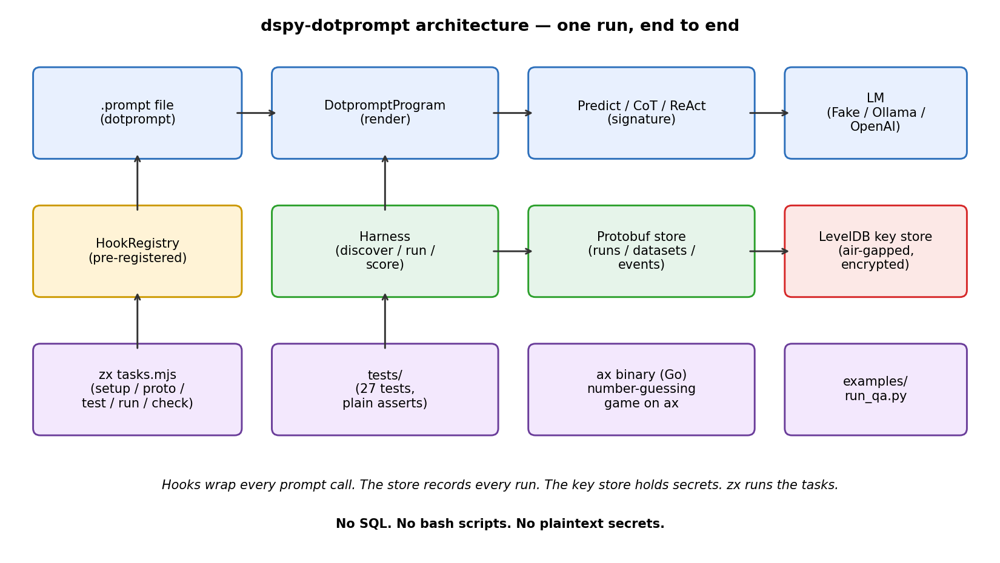
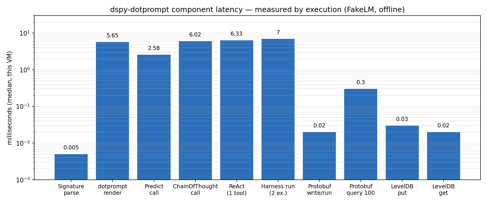
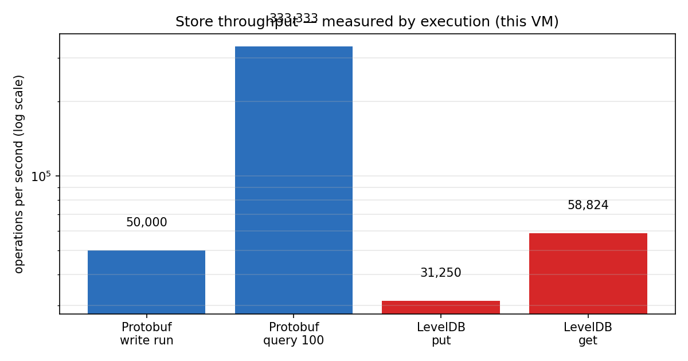

# dspy-dotprompt

In legacy of SnapKitty.

[](https://github.com/AHMADALIPARR/sovereign-snapkitty/actions/workflows/check.yml)
[](https://www.apache.org/licenses/LICENSE-2.0)
[](https://www.python.org/)
[](https://nodejs.org/)
[](https://go.dev/)

A custom DSPy-style DSL and harness built on Google's
[dotprompt](https://github.com/google/dotprompt) prompt format, with
pre-registered prompt hooks. It replaces four things at once: SQL with a
Protobuf Editions binary store, bash scripts with a zx task runner,
plaintext secrets with an air-gapped LevelDB key store, and stock DSPy
with a hand-rolled DSPy-style DSL that the owner controls end to end.



## What this is

`dspy-dotprompt` is a small, complete system for defining language-model
programs as data, running them, scoring them, and keeping the record. A
program is a dotprompt `.prompt` file plus a DSPy-style signature. The
signature is the contract (`"question -> answer"`). The `.prompt` file
carries the model, the input and output schemas, and the Handlebars
template. A module (`Predict`, `ChainOfThought`, `ReAct`) runs the
signature through the prompt and a language model. A harness discovers
the programs, runs them over a dataset, scores every example, and records
the whole run. Hooks wrap every prompt call. The store keeps every run.
The key store holds the secrets. The task runner runs the tasks.

Four replacements, one repo:

| Instead of | This uses | Why |
|---|---|---|
| SQL tables | **Protobuf Editions** binary store | No database server, no query language, no migrations. The schema is a `.proto` file; the data is length-delimited binary records you can read with any Protobuf implementation. |
| bash scripts | **zx** task runner | Every shell command runs through zx backticks (`` $`...` ``), so tasks read as shell commands with real variables and error handling, not as a pile of `.sh` files. |
| env vars / plaintext secrets | **LevelDB** air-gapped key store | Secrets live in a local LevelDB database, encrypted at rest. The store makes no network calls. The directory is owner-only. |
| stock DSPy | hand-rolled DSPy-style DSL | The DSL is the owner's code (`Signature`, `Predict`, `ChainOfThought`, `ReAct`). No framework to fight, no upstream to wait on. |

The DSL is Python because DSPy and dotpromptz are Python-only. The
harness is I/O-bound — the time is spent waiting on the language model,
not on the harness — so the language of the harness is not the bottleneck.

## Photos — rendered from measured data

The latency chart is the measured median of each component on the
verification VM (FakeLM, offline, 20 runs each). The throughput chart is
the measured operations per second of the two stores.





## Benchmarks — measured by execution

Every number below was measured by running the code on the verification
VM (~1.5 CPU, ~6 GB RAM, no GPU) on 2026-11-18. Timings are wall-clock
medians over 20 runs unless stated otherwise. No number here is estimated.

| Component | What was measured | Result |
|---|---|---|
| Signature parse | `Signature("question, context -> reasoning, answer")` | **0.005 ms** |
| dotprompt render | render `qa.prompt` with one input | **5.65 ms** |
| Predict call | one call, FakeLM, single output field | **2.58 ms** |
| ChainOfThought call | one call, FakeLM, reasoning + answer | **6.02 ms** |
| ReAct call | one call, one tool (`add`) | **6.33 ms** |
| Harness run | 2 examples, 2/2 pass, recorded to the store | **7.0 ms** |
| Protobuf store write | write 100 run records | **2.0 ms** (0.02 ms/run, ~50,000 runs/s) |
| Protobuf store query | load 100 runs filtered by program | **0.3 ms** (~333,000 rows/s) |
| Protobuf store get | fetch one run by id | **0.19 ms** |
| LevelDB keystore put | 100 puts | **3.2 ms** (0.03 ms/op, ~31,000/s) |
| LevelDB keystore get | 100 gets | **1.7 ms** (0.02 ms/op, ~59,000/s) |
| ax binary run | run the Go number-guessing game | **78 ms** median over 5 runs (range 14–211 ms) |
| Test suite | 27 tests, plain asserts | **6.8 s** |
| zx check | proto + test + run, end to end | **10.2 s** |

Repo scale: **42 files**, **1,527 lines** of Python in 9 files, plus the
`.proto` schema, 3 `.prompt` files, the zx task runner, and the Go ax
game. The test suite is **27 tests**, all passing.

The takeaway from the numbers is that the harness is cheap. Rendering a
prompt costs about 6 ms, a Predict call about 3 ms, and the stores are
sub-millisecond per operation. The language model dominates every real
run; the harness itself is noise next to it. That is the point: the
scaffolding gets out of the way.

## How to use it

### Install

```bash
git clone https://github.com/AHMADALIPARR/sovereign-snapkitty.git
cd dspy-dotprompt
zx tasks.mjs setup     # venv + Python deps (dotpromptz, protobuf, cryptography)
```

`setup` creates `.tools/dspy-dotprompt-venv` (in the workspace-level
`.tools` dir, so it survives VM swaps) and installs the Python
dependencies. The zx runner needs Node 22; the key-store tests need the
LevelDB shared library (built from source — see "Key store" below).

### Write a prompt

A program starts as a `.prompt` file. This is the dotprompt format: YAML
frontmatter (model, input schema, output schema, config) on top, a
Handlebars template below. The template uses `{{role}}` to mark turns and
`{{variable}}` to fill inputs.

```handlebars
---
model: googleai/gemini-flash-latest
input:
  schema:
    question: string
output:
  format: text
  schema:
    answer: string, the answer to the question
---
{{role "system"}}
You are a helpful assistant. Answer the question briefly and exactly.

{{role "user"}}
Answer this question: {{question}}
```

Save it as `prompts/qa.prompt`. The harness discovers every `.prompt`
file in `prompts/` by name.

### Run a program

```python
from dspy_dotprompt import FakeLM, Predict, Signature, DotpromptProgram

lm = FakeLM(responses={"What is 2+2?": "Answer: 4"})
prog = DotpromptProgram("prompts/qa.prompt", name="qa")
pred = Predict(Signature("question -> answer"), prog, lm)(question="What is 2+2?")
pred.answer  # "4"
```

`Signature("question -> answer")` is the contract. `Predict` validates
that the inputs match the signature, renders the `.prompt` file with
those inputs, calls the LM, and parses the reply back into the
signature's output fields. Parsing handles three shapes: a JSON object
whose keys are the output fields, `field: value` lines (matched
case-insensitively, so a model that writes `Answer: 4` fills the
`answer` field), and a single output field, which takes the whole reply.

`FakeLM` is deterministic: it returns a canned reply when a substring
appears in the prompt, and a default otherwise. The longest matching
substring wins, so a later observation in a ReAct transcript beats the
original question that is still in the history. Use it for tests and
offline runs. For a real model, use `OllamaLM("llama3.2")` (a local
Ollama server) or `OpenAILM("gpt-4o-mini")` (needs `OPENAI_API_KEY`, or
load the key from the key store).

### Think first, then answer

`ChainOfThought` is `Predict` with a `reasoning` output field prepended.
The model is asked to think step by step, then give the final answer.
The reply is split into `reasoning` and the answer fields.

```python
from dspy_dotprompt import ChainOfThought

pred = ChainOfThought(Signature("question -> answer"), prog, lm)(question="What is 2+2?")
pred.reasoning  # "2 plus 2 is 4."
pred.answer     # "4"
```

### Use tools

`ReAct` interleaves reasoning, tool calls, and observations. Tools are
plain callables registered by name. The LM emits `Thought:` and
`Action: tool_name(arg)` lines; the harness executes the tool, feeds the
result back as an `Observation:`, and repeats until the LM emits
`Answer:` or the step limit (default 5) is hit.

```python
from dspy_dotprompt import ReAct

def add(arg):
    a, b = arg.split(",")
    return str(int(a) + int(b))

pred = ReAct(
    Signature("question -> answer"), prog, lm,
    tools={"add": add},
)(question="What is 2+2?")
pred.answer       # "4"
pred["trajectory"]  # the full Thought / Action / Observation transcript
```

### Register hooks before you run

Hooks are registered **before** any prompt runs — at import time or at
setup — so by the time a program executes, the full hook chain is already
in place. That is what "pre-registered" means here: registration happens
up front, and execution just reads the registry.

```python
from dspy_dotprompt import register_hook

@register_hook("before_prompt")
def normalise(ctx):
    inputs = dict(ctx.inputs)
    inputs["question"] = inputs["question"].strip()
    return inputs

@register_hook("after_prompt")
def uppercase_answer(ctx):
    return ctx.output.upper()

@register_hook("on_error")
def fallback(ctx):
    return "Answer: unknown"
```

There are three hook points. `before_prompt` runs after inputs are
validated and before the prompt is rendered; it may return replacement
inputs, or raise to abort the run. `after_prompt` runs after the LM
returns text and before the output is parsed; it may return replacement
output text. `on_error` runs when a prompt execution raises; it may
return replacement output text as a fallback, or return nothing and let
the error propagate. Three hooks are registered on import:
`validate_inputs` (blocks a run when an input is missing or blank),
`strip_output` (trims the LM reply), and `log` (records the program,
inputs, and output to `HOOK_LOG` for audit). A program or harness can be
given its own `HookRegistry` instead of the global `HOOKS`.

### Run the harness

The harness discovers programs, runs them over a dataset, scores every
example with a metric, and records the whole run to the Protobuf store.

```python
from dspy_dotprompt import FakeLM, Harness, ProtobufStore, Signature, exact_match

store = ProtobufStore(".store")
harness = Harness("prompts", FakeLM(...), store=store)

dataset = [
    {"id": "e1", "inputs": {"question": "What is 2+2?"}, "expected": {"answer": "4"}},
    {"id": "e2", "inputs": {"question": "What is the capital of France?"}, "expected": {"answer": "Paris"}},
]
summary = harness.run("qa", dataset, exact_match, Signature("question -> answer"))
# {'run_id': 'e6211503d8a1', 'program': 'qa', 'dataset': 'inline',
#  'total': 2, 'passed': 2, 'pass_rate': 1.0, 'mean_latency_ms': 90.5, 'failures': []}
```

A metric is `metric(example, prediction) -> float` in [0, 1] (a bool is
coerced). `exact_match` compares the first expected output field to the
prediction's matching field. `harness.evaluate_all(dataset, metric,
signature)` runs every discovered program over the same dataset. Pass a
dataset name instead of a list and the harness loads it from the store.

### Query the store (no SQL)

The store is three binary files (`datasets.bin`, `runs.bin`,
`events.bin`) in a directory. Each record is a varint length prefix
followed by the Protobuf message bytes. Queries are reads + filters —
the same operations SQL would do, without a server.

```python
store.load_runs(program="qa", min_pass_rate=1.0)   # newest first
store.get_run("e6211503d8a1")                      # one run by id
store.load_events(program="qa", kind="after_prompt")
store.load_dataset("qa-demo")
store.list_datasets()
```

The schema is `proto/harness.proto` (`edition = "2024"`). It defines
`Dataset`, `Example`, `RunRecord`, `RunResult`, and `HookEvent`. Regenerate
the Python bindings after editing the schema with `zx tasks.mjs proto`
(it runs `grpc_tools.protoc`).

### Keep secrets in the key store

Secrets live in a local LevelDB database, encrypted at rest. The store
makes no network calls; the directory is owner-only (0700). Values are
encrypted with Fernet (AES-128-CBC + HMAC-SHA256); the key is derived
from a passphrase with PBKDF2-HMAC-SHA256 (600,000 iterations). The salt
is stored unencrypted under a reserved key. Without the passphrase the
values are opaque bytes.

```python
from dspy_dotprompt import LevelDBKeyStore

with LevelDBKeyStore(".keys", "my-passphrase") as ks:
    ks.put("openai_api_key", "sk-...")
    ks.get("openai_api_key")   # "sk-..."
    ks.list_keys()             # ["openai_api_key"]
```

LevelDB is built from https://github.com/google/leveldb. The build lives
in `~/workspace/.tools/leveldb-build/` (`libleveldb.so.1.23.0`). The
Python side is a small `ctypes` binding to the LevelDB C API — no
third-party LevelDB binding. Set `LEVELDB_LIB` to point at a different
build. A wrong passphrase raises `ValueError`; the plaintext never
appears in the database files (verified by test).

### Run the tasks (zx, not bash)

`tasks.mjs` is the task runner. Every shell command runs through zx
backticks (`` $`...` ``).

```
zx tasks.mjs setup    # venv + Python deps
zx tasks.mjs proto    # compile proto/harness.proto
zx tasks.mjs test     # 27-test Python suite
zx tasks.mjs run      # example harness (FakeLM, offline)
zx tasks.mjs check    # proto + test + run
zx tasks.mjs clean    # remove build artifacts
```

`zx tasks.mjs check` is the whole verification in one command. It exits
0 when the proto compiles, all 27 tests pass, and the example runs 2/2.

## The ax binary (Go)

`~/workspace/ax-games/axgames` is a separate, companion binary: a
turn-based number-guessing game built on Google's
[ax](https://github.com/google/ax) Go library. Two ax agents play — a
Setter picks a secret in [1, 100] and never reveals it; a Guesser
binary-searches from too-high / too-low feedback. Both are real ax
`Task`s, driven through the ax Task lifecycle (IDLE → WORKING →
COMPLETED / SUCCEEDED). It is a 17.9 MB statically linked Go binary,
`go vet` clean, and runs in a median 78 ms with no key and no network.
The secret is fixed (42) and the Guesser binary-searches, so it proves
the ax agent loop and the game logic compile and run as a real binary —
it does not run an ax server, a cluster, or a real model. The source and
the full record are in `~/workspace/ax-games/` with its own STATUS.md.

## Verification

`zx tasks.mjs check` exit 0 on the verification VM (2026-11-18):

- Proto compiles (Editions 2024, protobuf 7.36.2) and round-trips.
- **27/27 tests pass** (plain asserts, no pytest dependency):
  Signature (7), Predict / ChainOfThought / ReAct / rendering (5),
  hooks (5), Protobuf store (3), LevelDB key store (3), harness (4).
- The example (`examples/run_qa.py`) runs the QA program over 2
  examples, 2/2 pass, and records the run + events to the Protobuf
  store.
- `OllamaLM` raises a clean `ConnectionError` when Ollama is not
  running (no hang). `OpenAILM` is implemented but was not called here
  (no key on this VM). The ax binary runs exit 0, deterministic.

CI runs the same check on every push (`.github/workflows/check.yml`):
Python + Node setup, Python deps, zx install, LevelDB built from source,
proto compile, test suite, example harness.

## Design decisions

A few decisions in this repo are load-bearing, and they were made by
running the code, not by reading the docs.

**The DSL is hand-rolled, not the stock dspy library.** Stock DSPy
carries a framework the owner does not control. The DSL here is three
small classes (`Signature`, `Predict`, `ChainOfThought`, `ReAct`) and a
`DotpromptProgram` that renders a `.prompt` file. The whole thing is
auditable in an afternoon, and there is no upstream to wait on when a
behavior needs to change.

**Hooks are pre-registered, not per-call.** The hook chain is fixed at
import time and setup time, before any prompt runs. A run reads the
registry; it never builds it. That means a hook cannot be added halfway
through a run and change the behavior of the next example — the chain
you start with is the chain you run with. The built-in hooks
(`validate_inputs`, `strip_output`, `log`) are registered on import for
the same reason: they are always there, not opt-in per call.

**Output parsing is forgiving on purpose.** A language model does not
always emit the format you asked for. The parser accepts three shapes:
a JSON object keyed by the output fields, `field: value` lines matched
case-insensitively (a model that writes `Answer: 4` fills the `answer`
field), and a single output field taking the whole reply. The forgiving
parse is what makes a real model usable; a strict parser would fail on
half the replies and the harness would report a model problem that is
really a parsing problem.

**FakeLM matches the longest substring.** A ReAct transcript accumulates
history — the original question stays in the prompt while new
observations arrive. Matching the longest substring means a later
`Observation: 4` beats the original `2+2` in the history, so the fake
model answers from the newest evidence, the way a real model would.

**The store is length-delimited Protobuf, not SQLite.** A record is a
varint length prefix plus the message bytes. There is no server, no
connection, no migration. Any Protobuf implementation in any language
can read the files. Editions 2024 gives explicit field presence by
default, so an empty field and an absent field stay distinct.

**The key store is a `ctypes` binding, not a third-party package.** The
LevelDB C API is small (open, put, get, delete, iterator) and the binding
is a few dozen lines. No third-party LevelDB binding means no extra
dependency to audit and no wrapper that can leak the plaintext. The
encryption is Fernet over PBKDF2-HMAC-SHA256 (600,000 iterations), and
the passphrase is never stored.

**zx replaces bash.** Every shell command runs through zx backticks, so
the task file reads as shell commands with real variables and real error
handling. There are no `.sh` files to maintain, and the tasks are the
same commands a human would type.

**The venv lives in the workspace `.tools` dir, not in the project.**
VM replacements wipe system packages but keep `~/workspace`. A venv
inside the project would be wiped with the project on a bad day; a venv
in `~/workspace/.tools` survives. The same rule applies to the Go
toolchain, the LevelDB build, and the Elixir and Erlang toolchains.

## Repository layout

```
dspy-dotprompt/
  src/dspy_dotprompt/
    signature.py    Signature, Field, Prediction
    lm.py           BaseLM, FakeLM, OllamaLM, OpenAILM
    hooks.py        HookRegistry, register_hook, HOOKS, built-in hooks
    program.py      DotpromptProgram, Predict, ChainOfThought, ReAct
    store.py        ProtobufStore (datasets / runs / events)
    keystore.py     LevelDBKeyStore (ctypes binding to the LevelDB C API)
    harness.py      Harness, exact_match
    harness_pb2.py  generated from proto/harness.proto (do not edit)
  proto/harness.proto        Editions 2024 schema
  prompts/                   qa, summarize, extract_person (.prompt)
  tasks.mjs                  zx task runner
  tests/                     27 tests + run_tests.py
  examples/run_qa.py         end-to-end QA run (FakeLM + a custom hook)
  docs/images/               architecture + benchmark charts (PNG)
  .github/workflows/check.yml
  pyproject.toml  README.md  STATUS.md
```

## License

Apache License 2.0. See [LICENSE](LICENSE). dotprompt, zx, LevelDB,
and ax are Google projects under the Apache License 2.0; this repo's
own code is Apache-2.0 as well.
